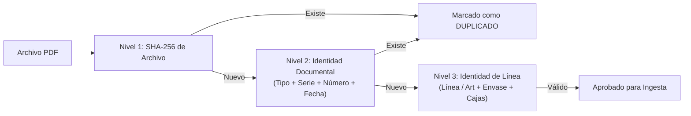

# BUSINESS_RULES.md — Reglas de Negocio de STOCK-LIGHT

## 1. Definición de la Unidad de Existencia

En STOCK-LIGHT, la unidad elemental de existencia es el par biunívoco:

$$\text{Unidad de Stock} = \langle \text{NOMBRE NORMALIZADO DE ARTÍCULO}, \; \text{NOMBRE NORMALIZADO DE ENVASE} \rangle$$

### Principios Fundamentales:
1. **Identificación por Nombre Normalizado (D-003, T-004):**
   * La unidad de inventario se identifica por el **nombre normalizado** de artículo y envase, no por los códigos numéricos de ERP Hispatec.
   * *Motivo:* Los informes CSV de ERP (en particular el de ventas) no proporcionan códigos de artículo ni de envase, solo nombres, y en compras el mismo envase puede figurar con ligeras diferencias ortográficas (ej. «EPS 106 9x500» frente a «EPS 106 9X500»).
   * *Normalización pura (`normalizarNombre` en `src/Normalizacion.js`):* Convierte a mayúsculas, recorta espacios en extremos y colapsa secuencias de espacios en blanco internos (incluyendo tabuladores `\t` y espacios de no separación U+00A0) a un único espacio. **Conserva tildes, comas, puntos y signos ortográficos** (ej. `CARTON 40X30X9,5 MORESCO` y `CORUÑA` permanecen intactos).
   * *Dónde se normaliza (Reglas 1 y 2 de T-004):*
     * En `Libro._keyLibro(art, env)` y `MovementService._clave(art, env)`: normaliza ambas partes antes de ensamblar la clave `${normArt}|${normEnv}`. Si una parte normalizada resulta vacía o contiene el carácter separador `|`, se rechaza con error de validación y la operación no se aplica.
     * En `MovementService._aplicar(estado, mov)`: todo movimiento se normaliza en `codigo_articulo` y `codigo_envase` antes de procesarse y persistirse. Por derivación, las filas de `MOVIMIENTOS`, `CAPAS_FIFO`, `CONSUMOS_FIFO` y `STOCK_ACTUAL` guardan siempre nombres normalizados.
     * En filtros y comparaciones externas (`_findLayer`, `dividirCapaEntrada`, `previsualizarCorreccionHistorica`, `validarDocumento`, `conciliarStock`, `obtenerDetalleStock`, `obtenerDetallePartidas`): el texto recibido del cliente o fuentes externas se normaliza antes de contrastarse con los datos guardados.
2. **Relación $1:N$ (Artículo - Envase):** Un mismo artículo puede comercializarse y almacenarse en múltiples envases o presentaciones. Cada combinación constituye un saldo de inventario **completamente independiente**.
   * *Ejemplo:*
     * `TOMATE ROSA M | EPS 104` $\rightarrow$ Saldo A (ej. 150 cajas)
     * `TOMATE ROSA M | EPS 106 9X500` $\rightarrow$ Saldo B (ej. 80 cajas)
     * El consumo del Saldo A no afecta ni compensa el Saldo B.
3. **Unidad de Medida Exclusiva: CAJAS / ENVASES:**
   * El cálculo de inventario en STOCK-LIGHT se realiza **única y exclusivamente en Cajas / Envases**.
   * **Queda estrictamente prohibido usar Kilos para deducir o computar existencias.** Los kilos son un valor comercial o de báscula que no refleja el stock físico unitario de empaques.
4. **Propiedad CA de Hispatec:** La gestión o partición de existencias por la propiedad "CA" (Confección en Almacén / Campo) **NO forma parte del MVP** y no se implementa en esta fase.
5. **Grupos Comerciales:**
   * Los grupos comerciales (ej. "TOMATE ROSA") son exclusivamente una **capa de consulta, agregación y filtro visual**.
   * **No participan en el cálculo de stock ni en las deducciones FIFO.**
6. **Grupos de Envase:**
   * Las agrupaciones de envase (ej. "EPS", "JAPONÉS CARTÓN", "JAPI", "OTROS") constituyen una **capa puramente consultiva, de agregación y filtro visual**.
   * **No participan en:**
     * Cálculo de saldo de stock (la unidad de inventario sigue siendo estrictamente `CODIGO_ARTICULO + CODIGO_ENVASE`).
     * Creación de movimientos en la tabla `MOVIMIENTOS`.
     * Consumo o deducción cronológica de capas FIFO.
     * Reconciliación o reconstrucción de existencias (`rebuildStock`).
   * Todo envase no mapeado formalmente en la tabla `GRUPOS_ENVASE` se clasifica sin conjeturas como `SIN_CLASIFICAR`.

### 1.4. Catálogo y Clasificación Configurable (D-029, T-005)
El catálogo resuelve qué combinaciones `(articulo, envase)` se siguen, qué atributos tienen y en qué grupos de vista se muestran, mediante **cuatro hojas configurables** sin lógica de negocio escrita a fuego en el motor:

1. **Las 4 hojas del catálogo:**
   * `ATRIBUTOS` (`nombre, descripcion, activo`): Define las dimensiones que el catálogo puede asignar a una combinación (ej. `SEGUIMIENTO`, `FAMILIA`, `MATERIAL`, `PROGRAMA`, `REVISAR`).
   * `REGLAS_CLASIFICACION` (`id, atributo, valor, prioridad, articulo_contiene, articulo_excluye, envase_contiene, envase_excluye, activo, observaciones`): Asigna el valor de un atributo por patrones de texto sobre artículo y envase normalizados.
   * `CATALOGO` (`articulo, envase, atributo, valor, activo, observaciones`): Excepciones explícitas para un par exacto `(articulo, envase)` y un atributo concreto.
   * `AGRUPACIONES` (`agrupacion, orden, grupo, subgrupo, filtro, activo`): Vistas jerárquicas (como `COMERCIAL`) que proyectan los atributos calculados en `(grupo, subgrupo)` según su orden.

2. **Orden de resolución por atributo y agrupación (`src/Catalogo.js`):**
   * **Paso 1 — Normalización:** `articulo` y `envase` se normalizan con `normalizarNombre` (D-003). Si alguno queda vacío, la combinación no es seguida (`SEGUIMIENTO: 'NO_SEGUIDA'`).
   * **Paso 2 — Resolución de cada atributo activo:** Para cada atributo activo en `ATRIBUTOS`:
     1. **Excepción exacta (`CATALOGO`):** Si existe una fila activa en `CATALOGO` para `(articulo, envase, atributo)`, se toma su `valor` y no se evalúan reglas para ese atributo (no pisa otros atributos).
     2. **Reglas por prioridad (`REGLAS_CLASIFICACION`):** Si no hay excepción, se evalúan las reglas activas de ese `atributo` ordenadas por `prioridad` ascendente (en empate, por orden de fila). La primera que encaja fija el valor del atributo.
        * Sintaxis de `*_contiene` y `*_excluye`: `;` separa alternativas (**O**); dentro de cada alternativa, `+` separa términos que deben aparecer todos (**Y**). Un campo vacío en `*_contiene` no restringe; en `*_excluye` no excluye nada.
   * **Paso 3 — Estado de seguimiento (`SEGUIMIENTO`):**
     * `SEGUIMIENTO = 'SI'` $\rightarrow$ `'SEGUIDA'`
     * `SEGUIMIENTO = 'NO'` $\rightarrow$ `'NO_SEGUIDA'`
     * Sin valor asignado $\rightarrow$ `'PENDIENTE'`
   * **Paso 4 — Proyección en agrupaciones (`AGRUPACIONES`):**
     * Si el estado es `'SEGUIDA'`, para cada `agrupacion` activa se recorren sus filas por `orden` ascendente y gana la primera cuyo `filtro` se cumpla. Si ninguna fila encaja, queda `{ grupo: 'SIN_CLASIFICAR', subgrupo: '' }`.

3. **Sintaxis de filtros en `AGRUPACIONES` (`cumpleFiltro`):**
   * Condiciones separadas por `;` (**Y lógico**: deben cumplirse todas). Un filtro vacío (`""`) encaja con cualquier combinación seguida.
   * Cada condición admite:
     * `ATRIBUTO=V1|V2`: el valor del atributo es `V1` o `V2`.
     * `ATRIBUTO!=V1|V2`: el valor del atributo no es ni `V1` ni `V2` (incluye atributo sin valor).
     * `ATRIBUTO=*`: el atributo tiene algún valor no vacío.
     * `ATRIBUTO=`: el atributo no tiene valor asignado.

4. **Semilla inicial (`src/SemillaCatalogo.js`):**
   * Toda la configuración inicial de negocio (5 atributos, 16 reglas de clasificación, 11 filas de la agrupación `COMERCIAL` y `METADATOS_GRUPOS_COMERCIALES`) vive aislada en `src/SemillaCatalogo.js`. El motor (`Catalogo.js`), el servicio (`CatalogoService.js`) y la fachada (`CommercialGroupResolver.js`) no contienen ningún nombre de producto, cliente ni envase.
   * En la agrupación `COMERCIAL`, el orden de precedencia sitúa `CARREFOUR` (orden 1) y `EPS` (orden 2) antes de las familias específicas y genéricas; `TOMATE ROSA SABOR` en madera se clasifica en `JAPI_JAPONES / ROSA_DE_SABOR` (orden 6) y en cartón en `CARTON / ROSA` (orden 8).

---

## 2. Ecuación Maestra de Inventario e Inmutabilidad

$$\text{EXISTENCIAS ACTUALES} = \sum \text{ENTRADAS} - \sum \text{SALIDAS} \pm \sum \text{AJUSTES}$$

### Regla de Oro de Inmutabilidad (Libro de Solo Añadir — D-012, D-022, D-024):
* **Las existencias jamás se editan directamente en la base de datos.**
* Ningún usuario ni proceso puede modificar el número de stock sin que exista un registro inmutable en la tabla `MOVIMIENTOS`.
* **El libro `MOVIMIENTOS` es estrictamente de solo añadir (`append-only`).** Ninguna operación ni corrección histórica modifica ni borra una fila existente de `MOVIMIENTOS`.
* Todos los identificadores (`MOV`, `CAPA`, `DOC`) se generan con UUID mediante `nuevoId(prefijo)` (`src/Ids.js`, D-024), nunca con `Date.now()`.
* Toda variación de saldo, tanto en vivo como en reconstrucción (`reconstruir(movimientos)` en `src/Libro.js`), se rige por la siguiente tabla de semántica única:

| Movimiento | Efecto |
| :--- | :--- |
| `ENTRADA`, o `AJUSTE +` sin `id_capa_objetivo` | Crea la capa `id_capa_creada` con `fecha_capa = fecha_negocio` y `proveedor = entidad_nombre` |
| `AJUSTE +` con `id_capa_objetivo` | Devuelve cajas a esa capa (restitución) |
| `SALIDA`, o `AJUSTE −` sin `id_capa_objetivo` | Consume por FIFO y anota los consumos |
| `AJUSTE −` con `id_capa_objetivo` | Consume solo de esa capa (consumo dirigido) |
| `ANULACION` con `id_movimiento_ref` = una entrada | Consume todo lo que quede en la capa creada por ella y la marca `ANULADA`. Si la capa ya tiene consumos, error |
| `ANULACION` con `id_movimiento_ref` = una salida o un `AJUSTE −` | Devuelve a cada capa exactamente lo que ese movimiento consumió, según `consumosPorMovimiento` (D-012) |

* **Equivalencias de correcciones históricas (D-022):**
  * **Anular entrada o salida:** un movimiento `ANULACION` con `estado = 'CONFIRMADO'` y `id_movimiento_ref`.
  * **Corregir la cantidad de una salida a la baja:** `AJUSTE +` con `id_movimiento_ref` a la salida (devuelve las cajas a las capas de esa salida en orden inverso al consumo).
  * **Corregir una salida al alza:** `AJUSTE −` por FIFO con `id_movimiento_ref`.
  * **Corregir la cantidad de una entrada:** `AJUSTE ±` con `id_capa_objetivo` = su capa (`cajas_iniciales` de la capa no se toca).
  * **Dividir capa, corregir entrada parcial, reclasificar y mover partida:** combinaciones de consumo dirigido (`AJUSTE −` con `id_capa_objetivo`) + creación de capas (`AJUSTE +` con `id_capa_creada`), conservando la fecha y el proveedor de la capa de origen.

---

## 3. Fuentes de Movimiento Documental

### 3.1. Entradas de Mercancía en el MVP Activo

En el MVP actual de STOCK-LIGHT, las entradas de inventario proceden **únicamente de Albaranes de Compra**:

#### A) Albarán de Compra (Fuente Activa Exclusiva de Entradas)
* **Función:** Refleja compras directas de producto a proveedores o agricultores (Series `ACT`, `NT`, etc.).
* **Extracción requerida:**
  * Fecha de albarán.
  * Serie y Número de documento.
  * Proveedor (Código y Razón Social).
  * Código de Artículo y Descripción.
  * Código de Envase y Descripción.
  * **Número de Envases / Bultos / Cajas** (Dato crítico de stock).
  * Partida (si existe en el documento; se conserva como atributo informativo).
* **Tratamiento:** Cada línea de artículo genera una nueva capa FIFO y un movimiento tipo `ENTRADA`.

#### B) Documento de Recepción de Mercancía (Fuera del MVP Activo)
> [!NOTE]
> La ingesta de documentos de recepción de mercancía (medianería) ha quedado **fuera del alcance del MVP activo** según la Fase 2.1. El parser correspondiente permanece desacoplado e inactivo y no forma parte del flujo de importación ni de la inicialización del sistema.

### 3.2. Salidas de Mercancía

* Las salidas proceden exclusivamente de **Albaranes de Salida** de Hispatec.
* **Extracción requerida:**
  * Fecha de salida.
  * Serie y Número de documento.
  * Cliente (Razón Social).
  * Código de Artículo y Descripción.
  * Envase / Presentación.
  * **Cajas reales despachadas**.
* **Tratamiento:** Descuenta cajas de las capas FIFO correspondientes.

### 3.3. Documentos e Informes Excluidos del MVP
* **Informes de "Análisis de ventas por partida":** Quedan **estrictamente excluidos** como fuente de inventario. Dichos informes consolidan o duplican partidas por ventas parciales y desvirtúan el flujo cronológico de documentos primarios.

---

## 4. Motor FIFO (First-In, First-Out)

### 4.1. Filosofía FIFO en STOCK-LIGHT
* FIFO es una **regla determinista de cálculo de existencias**, **no un sistema de trazabilidad física**.
* La herramienta no pretende certificar qué palet o caja física exacta cargó el transportista en el muelle; garantiza que el stock disponible contablemente se valore y agote en estricto orden cronológico de entrada.

### 4.2. Estructura y Ciclo de Vida de las Capas FIFO
Cada entrada genera una **Capa FIFO** con los siguientes atributos:
* `id_capa`: Identificador secuencial unívoco.
* `id_movimiento_entrada`: Vínculo al movimiento origen.
* `fecha`: Fecha de entrada del documento.
* `codigo_articulo` y `codigo_envase`: Clave de stock.
* `cajas_iniciales`: Cantidad original ingresada.
* `cajas_restantes`: Saldo vivo pendiente de consumo.
* `partida`: Partida física asociada (informativa).
* `documento_ref`: Referencia del albarán de compra o recepción.
* `estado`: `ACTIVA` si $\text{cajas\_restantes} > 0$; `AGOTADA` si $\text{cajas\_restantes} = 0$.

### 4.3. Algoritmo de Consumo en Salidas
Ante un movimiento de salida de $N$ cajas para el par $\langle \text{artículo}, \text{envase} \rangle$:
1. Se recuperan todas las capas con estado `ACTIVA` ordenadas por `fecha ASC, id_capa ASC`.
2. Se verifica que $\sum \text{cajas\_restantes} \ge N$.
3. Se itera secuencialmente consumiendo saldo:
   * Si la capa actual tiene $\le$ cajas que las requeridas: se agota la capa ($\text{cajas\_restantes} = 0$, estado `AGOTADA`) y se descuenta dicha porción de la necesidad.
   * Si la capa actual tiene $>$ cajas que las requeridas: se deduce la cantidad exacta ($\text{cajas\_restantes} = \text{cajas\_restantes} - \text{cajas\_solicitadas}$) y la necesidad queda cubierta.
4. Las capas con $\text{cajas\_restantes} > 0$ se conservan vivas para las jornadas siguientes.

### 4.4. Operativa Diaria y Arrastre de Saldo
* El sistema **no recalcula toda la historia desde el origen de los tiempos cada día**.
* La operativa diaria trabaja arrastrando el conjunto de **capas vivas**. Las capas agotadas en días anteriores pasan a histórico y no participan en iteraciones posteriores.

---

## 5. Política de Stock Insuficiente (Déficit y Saldo Negativo)

### Prohibición de Stock Negativo Silencioso:
* El sistema **nunca permitirá que una salida genere saldo negativo de forma invisible**.
* Si una salida solicita $N$ cajas y el stock disponible actual es $S < N$:
  1. El movimiento **NO se aplica directamente al stock ni a las capas FIFO**.
  2. El documento se marca automáticamente con el estado:  
     `STOCK_INSUFICIENTE / PENDIENTE_REVISION`.
  3. El sistema expone el desglose de discrepancia:
     * **Stock disponible en capas:** $S$ cajas.
     * **Cajas requeridas en documento:** $N$ cajas.
     * **Déficit a justificar:** $N - S$ cajas.
  4. El usuario responsable deberá resolver el déficit mediante:
     * La importación de un albarán de entrada que faltaba por procesar.
     * Un ajuste manual debidamente justificado (ej. corrección de inventario inicial).

---

## 6. Ajustes Manuales de Inventario

Cuando se producen situaciones físicas reales que difieren del flujo documental estándar (roturas, destríos, mermas, diferencias en recuentos de almacén o reprocesados/reconversiones físicas):
* **NO se implementan conversiones automáticas complejas ni reprocesados en el código.**
* Toda corrección se efectúa mediante **Ajustes Manuales Tipificados**.

### Catálogo de Motivos de Ajuste:
| Motivo | Signo Habitual | Descripción |
| :--- | :---: | :--- |
| `MERMA` | `-` | Pérdida de peso o producto desechado por tiempo/calidad |
| `ROTURA` | `-` | Daño accidental de cajas o envases durante manipulación |
| `DETERIORO` | `-` | Producto no apto comercialmente |
| `DIFERENCIA_INVENTARIO` | `+` / `-` | Ajuste tras recuento físico periódico en almacén |
| `CORRECCION` | `+` / `-` | Enmienda por error humano previo en digitación o lectura |
| `DESTRIO` | `-` | Destrío directo de una partida sin reproceso (D-011) |
| `REPROCESO_ORIGEN` | `-` | Retirada o consumo de partidas de origen en un reproceso (T-009, D-011) |
| `REPROCESO_DESTINO` | `+` | Creación de nuevas partidas resultantes de un reproceso (T-009, D-011) |

### 6.1. Reprocesos y Destrío (T-009, D-011, D-030, D-036)
Los reprocesos y cambios de envase ocurren a diario y no son registrados por ERP Hispatec (D-030). Se gestionan de forma atómica sobre el libro de movimientos:

1. **Estructura:**
   * **Orígenes (1..N):** Partidas seleccionadas explícitamente o combinación repartida por FIFO. Cada una genera un `AJUSTE −` con motivo `REPROCESO_ORIGEN` y consumo dirigido (`id_capa_objetivo`).
   * **Destinos (1..N):** Cada uno genera un `AJUSTE +` con motivo `REPROCESO_DESTINO`. Hereda como `fecha_negocio` la `fecha_capa` más antigua de las partidas de origen, y como proveedor el común de los orígenes o `VARIOS` si proceden de distintos proveedores (D-030). Si el origen es único, guarda `id_capa_origen`.
2. **Destrío (D-036):**
   * Es un **dato del reproceso** en cajas de origen, **no un movimiento de stock** (las cajas ya salieron con el ajuste negativo de origen).
   * **Mismo envase:** Si todos los orígenes y destinos tienen el mismo envase normalizado, `destrio_cajas` es opcional; si no se indica, vale $\max(0, \text{retirado} - \text{destinos})$.
   * **Cambio de envase:** Si algún envase difiere, `destrio_cajas` es **obligatorio** (puede ser 0); no se puede deducir.
   * **Prorrateo:** El destrío se reparte entre las partidas de origen en proporción a las cajas retiradas (enteros, y el resto a la capa con más cajas, sumando exactamente el total de destrío) para estadísticas de rendimiento por proveedor.
   * **Destrío directo:** El descarte de género sin reproceso se registra como `AJUSTE −` con motivo `DESTRIO`.
3. **Anulación:**
   * Un reproceso solo se puede anular si ninguna capa destino tiene consumos posteriores (`cajas_consumidas = 0`). Si tiene consumos, devuelve `REVISION_NECESARIA`.
   * Al anular, se registran movimientos `ANULACION`: las capas destino desaparecen y las cajas vuelven íntegras a las capas de origen según `CONSUMOS_FIFO` (D-012).

### Requisitos Obligatorios de un Ajuste:
Todo ajuste manual debe almacenar obligatoriamente:
* Marca temporal (`YYYY-MM-DD HH:mm:ss`).
* Correo / Identificador del usuario que ejecuta el ajuste.
* Clave de stock: Artículo + Envase.
* Cantidad de cajas y Signo (`+` o `-`).
* Motivo formal tipificado.
* Texto libre de observaciones / Justificación.

---

## 7. Estrategia Multicapa de Deduplicación

Para blindar al sistema frente a subidas accidentales dobles, importaciones solapadas por rangos de fechas o reintentos de red, se implementan tres niveles de comprobación:

1. **Nivel 1 (Hash SHA-256 del Archivo):** Si el binario exacto del PDF ya fue registrado previamente en la hoja `DOCUMENTOS`, se rechaza de inmediato sin procesar.
2. **Nivel 2 (Identidad Documental Compuesta):** Clave única `(tipo_documento, serie, numero, fecha)`. Si un usuario escaneó de nuevo el mismo documento físico con diferente resolución (cambiando el hash del archivo), el Nivel 2 detecta la coincidencia exacta de la serie y número de albarán.
3. **Nivel 3 (Tolerancia a Períodos Solapados):** Si se importan albaranes que cubren fechas concurrentes, el sistema filtra y descarta solo aquellos documentos individuales previamente consolidados, procesando únicamente los nuevos.
