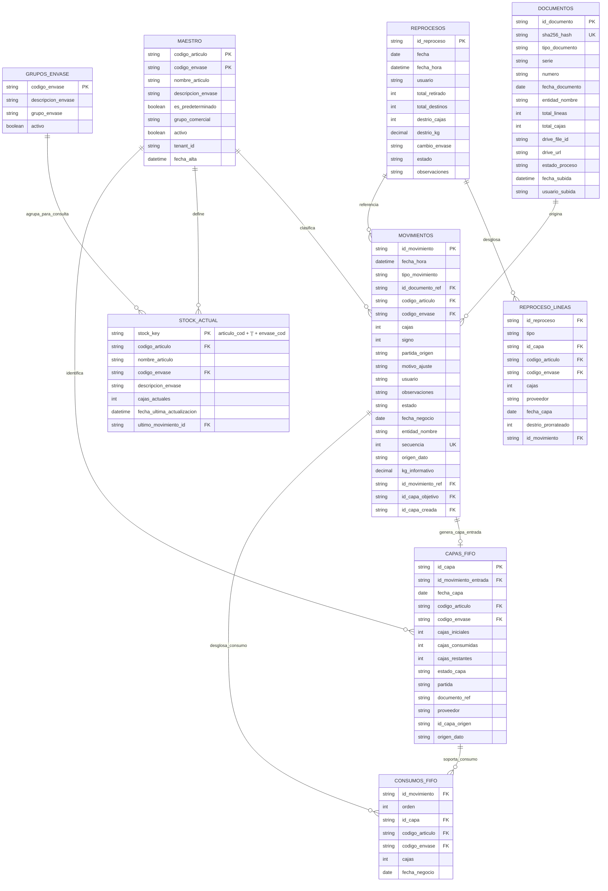

# DATA_MODEL.md — Modelo de Datos y Persistencia

## 1. Estrategia de Persistencia

La persistencia de STOCK-LIGHT se basa en un **Libro de Google Sheets dedicado**, administrado programáticamente por Google Apps Script.

### Principios de Almacenamiento:
1. **Google Sheets como Base de Datos Tabular:** Las pestañas de la hoja funcionan como tablas relacionales normalizadas.
2. **Cero Fórmulas de Negocio en Celdas:** No se utilizan fórmulas de hoja de cálculo (`VLOOKUP`, `SUMIFS`, `QUERY`, `IMPORTRANGE`) para calcular stocks o enlazar movimientos. Las fórmulas dinámicas provocan bloqueos, recálculos lentos e inconsistencias durante escrituras concurrentes. La lógica reside al 100% en Apps Script.
3. **Escritura y Lectura Atómica en Lote:** Todas las interacciones con `SpreadsheetApp` se efectúan mediante rangos contiguos (`getRange(1, 1, rows, cols).getValues()` y `.setValues()`), minimizando el tiempo de conexión con el servicio.
4. **Google Drive como Almacén de Binarios:** Los archivos PDF originales se custodian en una carpeta dedicada de Google Drive, guardando su identificador (`drive_file_id`) y enlace seguro en la tabla `DOCUMENTOS`.

---

## 2. Diagrama Entidad-Relación (ER)

---

## 3. Especificación Detallada de Tablas

### 3.1. Tabla: `MAESTRO`
Catálogo de referencia para validación y enriquecimiento de nombres de artículos y tipos de envase.

| Campo | Tipo | Nulo | Descripción / Regla |
| :--- | :--- | :---: | :--- |
| `codigo_articulo` | `VARCHAR(50)` | NO | Código oficial del artículo en Hispatec (PK compuesta). |
| `codigo_envase` | `VARCHAR(50)` | NO | Código o identificador del envase/caja (PK compuesta). |
| `nombre_articulo` | `VARCHAR(150)`| NO | Nombre legible de la variedad o producto. |
| `descripcion_envase` | `VARCHAR(100)`| NO | Descripción del formato (ej. "EPS 104", "Madera 50x30"). |
| `es_predeterminado` | `BOOLEAN` | SÍ | `TRUE` si es el envase predeterminado/habitual de compras para este artículo. |
| `grupo_comercial` | `VARCHAR(100)`| SÍ | Agrupación analítica (ej. "Tomate Rosa", "Calabacín"). Solo para filtros visuales. |
| `activo` | `BOOLEAN` | NO | `TRUE` si se encuentra en uso activo; `FALSE` si está descontinuado. |
| `tenant_id` | `VARCHAR(50)` | NO | Identificador del tenant/empresa (ej. "DEFAULT", "TENANT_PRINCIPAL"). |
| `fecha_alta` | `DATETIME` | NO | Fecha y hora de registro en el catálogo (`YYYY-MM-DD HH:mm:ss`). |

---

### 3.2. Tabla: `DOCUMENTOS`
Bitácora y trazabilidad de todos los archivos importados al sistema.

| Campo | Tipo | Nulo | Descripción / Regla |
| :--- | :--- | :---: | :--- |
| `id_documento` | `VARCHAR(50)` | NO | Clave primaria autogenerada (ej. `DOC-20260928-0001`). |
| `sha256_hash` | `VARCHAR(64)` | NO | Hash criptográfico del archivo PDF. Clave única de deduplicación binaria. |
| `tipo_documento` | `ENUM` | NO | `COMPRA`, `SALIDA` (`RECEPCION` reservado/inactivo fuera del MVP). |
| `serie` | `VARCHAR(20)` | NO | Serie del documento en Hispatec (ej. `ACT26`, `AVT26`). |
| `numero` | `VARCHAR(30)` | NO | Número correlativo del albarán en Hispatec. |
| `fecha_documento` | `DATE` | NO | Fecha de expedición del albarán (`YYYY-MM-DD`). |
| `entidad_nombre` | `VARCHAR(200)`| SÍ | Razón social del proveedor o cliente. |
| `total_lineas` | `INTEGER` | NO | Cantidad de líneas de stock reconocidas en el documento. |
| `total_cajas` | `INTEGER` | NO | Sumatorio total de cajas contabilizadas en el documento. |
| `drive_file_id` | `VARCHAR(100)`| NO | Identificador único del archivo alojado en Google Drive. |
| `drive_url` | `VARCHAR(255)`| NO | Enlace directo para visualización del PDF en Google Drive. |
| `estado_proceso` | `ENUM` | NO | `SUBIDO`, `PARSEADO`, `CONFIRMADO`, `DUPLICADO`, `ERROR`. |
| `fecha_subida` | `DATETIME` | NO | Marca temporal de la ingesta en el sistema. |
| `usuario_subida` | `VARCHAR(100)`| NO | Email del usuario que realizó la carga. |

---

### 3.3. Tabla: `MOVIMIENTOS`
Libro diario inmutable de eventos de inventario. Cada fila representa un cambio atómico de cajas.

| Campo | Tipo | Nulo | Descripción / Regla |
| :--- | :--- | :---: | :--- |
| `id_movimiento` | `VARCHAR(50)` | NO | Clave primaria del movimiento (ej. `MOV-20260928-00001`). |
| `fecha_hora` | `DATETIME` | NO | Marca temporal del evento. |
| `tipo_movimiento` | `ENUM` | NO | `ENTRADA`, `SALIDA`, `AJUSTE`. |
| `id_documento_ref` | `VARCHAR(50)` | SÍ | Vínculo a `DOCUMENTOS.id_documento` (obligatorio en Entrada/Salida). |
| `codigo_articulo` | `VARCHAR(50)` | NO | Nombre normalizado de artículo (`normalizarNombre`, D-003, T-004). |
| `codigo_envase` | `VARCHAR(50)` | NO | Nombre normalizado del envase (`normalizarNombre`, D-003, T-004). |
| `cajas` | `INTEGER` | NO | Cantidad absoluta de cajas (> 0). |
| `signo` | `INTEGER` | NO | `+1` (incrementa stock) o `-1` (decrementa stock). |
| `partida_origen` | `VARCHAR(50)` | SÍ | Partida informada por Hispatec si aplica. |
| `motivo_ajuste` | `VARCHAR(50)` | SÍ | Obligatorio si `tipo_movimiento = AJUSTE` (`MERMA`, `ROTURA`, etc.). |
| `usuario` | `VARCHAR(100)`| NO | Email del usuario que confirma o ejecuta el movimiento. |
| `observaciones` | `TEXT` | SÍ | Notas complementarias o justificación del ajuste. |
| `estado` | `ENUM` | NO | `CONFIRMADO`, `PENDIENTE_REVISION`. |
| `fecha_negocio` | `DATE` | NO | Fecha de negocio del albarán/documento (D-008, formato YYYY-MM-DD en Europe/Madrid). Fija la antigüedad de la capa, no el orden de reproducción. |
| `entidad_nombre`| `VARCHAR(150)`| SÍ | Nombre del emisor/proveedor o cliente del documento. |
| `secuencia` | `INTEGER` | NO | Secuencia estrictamente creciente asignada dentro del lock. Define el orden determinista de reproducción en reconstrucción. |
| `origen_dato` | `ENUM` | NO | Origen documental (`CSV`, `PDF`, `FOTO`, `MANUAL`; D-023). Por defecto `MANUAL`. |
| `kg_informativo`| `DECIMAL` | SÍ | Kilos netos del documento para estadísticas y previsiones futuras (D-025). No computa en stock (D-004). |
| `id_movimiento_ref`| `VARCHAR(50)`| SÍ | Vínculo al movimiento original afectado (en anulaciones, correcciones de salida/entrada, divisiones y traspasos; D-022, T-022). |
| `id_capa_objetivo` | `VARCHAR(50)`| SÍ | Identificador de la capa FIFO específica sobre la que opera un ajuste dirigido o una anulación de entrada (D-022, T-022). |
| `id_capa_creada` | `VARCHAR(50)`| SÍ | Identificador de la capa FIFO creada por una entrada o ajuste positivo (garantiza que la reconstrucción preserve los mismos `id_capa` que el estado vivo; D-022, T-022). |

### 3.3.1. Semántica Canónica de Movimientos (Libro de Solo Añadir — D-012, D-022, T-022)
El libro de movimientos (`MOVIMIENTOS`) es **estrictamente de solo añadir** (`append-only`). Queda prohibido modificar o sobrescribir filas existentes. Tanto la operación en vivo como `reconstruir(movimientos)` aplican cada movimiento mediante la función pura `aplicarMovimiento(estado, movimiento)` de `src/Libro.js`, cuya única semántica es:

| Movimiento | Efecto |
| :--- | :--- |
| `ENTRADA`, o `AJUSTE +` sin `id_capa_objetivo` | Crea la capa `id_capa_creada` con `fecha_capa = fecha_negocio` y `proveedor = entidad_nombre` |
| `AJUSTE +` con `id_capa_objetivo` | Devuelve cajas a esa capa (restitución). `cajas_iniciales` no se toca |
| `SALIDA`, o `AJUSTE −` sin `id_capa_objetivo` | Consume por FIFO y anota los consumos en `consumosPorMovimiento` |
| `AJUSTE −` con `id_capa_objetivo` | Consume solo de esa capa (consumo dirigido). `cajas_iniciales` no se toca |
| `ANULACION` con `id_movimiento_ref` = una entrada | Consume todo lo que quede en la capa creada por ella y la marca `ANULADA`. Si la capa ya tiene consumos, error |
| `ANULACION` con `id_movimiento_ref` = una salida o un `AJUSTE −` | Devuelve a cada capa exactamente lo que ese movimiento consumió, según `consumosPorMovimiento` (D-012) |

*(Además, corregir una salida a la baja se registra como `AJUSTE +` con `id_movimiento_ref` apuntando a la salida, devolviendo las cajas a las capas consumidas por esa salida en orden inverso al consumo; corregir una salida al alza se registra como `AJUSTE −` por FIFO con `id_movimiento_ref`).*

---

### 3.4. Tabla: `CAPAS_FIFO`
Estructura de capas vivas e históricas para la asignación y consumo cronológico.

| Campo | Tipo | Nulo | Descripción / Regla |
| :--- | :--- | :---: | :--- |
| `id_capa` | `VARCHAR(50)` | NO | Clave primaria secuencial (ej. `CAPA-20260928-0001`). |
| `id_movimiento_entrada` | `VARCHAR(50)` | NO | Vínculo al movimiento de entrada que creó la capa. |
| `fecha_capa` | `DATE` | NO | Fecha de origen de la capa para ordenación FIFO (`YYYY-MM-DD`, coincide con `fecha_negocio`). |
| `codigo_articulo` | `VARCHAR(50)` | NO | Nombre normalizado de artículo (`normalizarNombre`, D-003, T-004). |
| `codigo_envase` | `VARCHAR(50)` | NO | Nombre normalizado de envase (`normalizarNombre`, D-003, T-004). |
| `cajas_iniciales` | `INTEGER` | NO | Saldo original con el que nació la capa. |
| `cajas_consumidas`| `INTEGER` | NO | Cantidad acumulada de cajas deducidas por salidas o mermas. |
| `cajas_restantes` | `INTEGER` | NO | Saldo disponible actual (`cajas_iniciales - cajas_consumidas`). |
| `estado_capa` | `ENUM` | NO | `ACTIVA` (si `cajas_restantes > 0`), `AGOTADA` (si `cajas_restantes = 0`). |
| `partida` | `VARCHAR(50)` | SÍ | Partida documental asociada. |
| `documento_ref` | `VARCHAR(50)` | NO | Serie/Número de albarán de compra o recepción. |
| `proveedor` | `VARCHAR(150)`| SÍ | Nombre del proveedor/emisor de la partida (D-016). |
| `id_capa_origen`| `VARCHAR(50)` | SÍ | ID de la capa previa si procede de reproceso, reclasificación o ajuste. |
| `origen_dato` | `ENUM` | NO | Origen documental (`CSV`, `PDF`, `FOTO`, `MANUAL`; D-023). |

---

### 3.5. Tabla: `STOCK_ACTUAL`
Capa de consulta rápida y materialización del saldo vivo por cada par `(codigo_articulo, codigo_envase)`.

| Campo | Tipo | Nulo | Descripción / Regla |
| :--- | :--- | :---: | :--- |
| `stock_key` | `VARCHAR(100)`| NO | Clave primaria única canónica: `${codigo_articulo}\|${codigo_envase}` por nombres normalizados (`_clave` en `MovementService.js`, D-003, T-004). |
| `codigo_articulo` | `VARCHAR(50)` | NO | Nombre normalizado de artículo (`normalizarNombre`, D-003, T-004). |
| `nombre_articulo` | `VARCHAR(150)`| NO | Nombre descriptivo del artículo (de MAESTRO, o fallback a `codigo_articulo` si no existe; T-004 Regla 4). |
| `codigo_envase` | `VARCHAR(50)` | NO | Nombre normalizado del envase (`normalizarNombre`, D-003, T-004). |
| `descripcion_envase`| `VARCHAR(100)`| NO | Nombre o descripción del envase (de MAESTRO, o fallback a `codigo_envase` si no existe; T-004 Regla 4). |
| `cajas_actuales` | `INTEGER` | NO | Saldo total de cajas disponibles ($\ge 0$). |
| `fecha_ultima_actualizacion` | `DATETIME` | NO | Fecha y hora del último movimiento aplicado. |
| `ultimo_movimiento_id` | `VARCHAR(50)` | NO | Identificador del último movimiento que alteró este saldo. |

---

### 3.6. Tabla: `CONSUMOS_FIFO`
Estructura derivada (D-022, T-003) que materializa la foto viva de consumos sobre capas FIFO (`estado.consumosPorMovimiento`).
Se reescribe íntegramente en `_persistir` y puede reconstruirse en cualquier momento a partir de `MOVIMIENTOS` mediante `reconstruir(movimientos)`. No almacena `FIFO:` como texto ni depende de repartos a ciegas.

| Campo | Tipo | Nulo | Descripción / Regla |
| :--- | :--- | :---: | :--- |
| `id_movimiento` | `VARCHAR(50)` | NO | Clave foránea al movimiento que consumió stock (`SALIDA` o `AJUSTE −`). |
| `orden` | `INTEGER` | NO | Posición correlativa (1, 2…) dentro de los consumos del movimiento. |
| `id_capa` | `VARCHAR(50)` | NO | Clave foránea a la capa de `CAPAS_FIFO` de la que se dedujeron las cajas. |
| `codigo_articulo` | `VARCHAR(50)` | NO | Nombre normalizado de artículo (`normalizarNombre`, D-003, T-004). |
| `codigo_envase` | `VARCHAR(50)` | NO | Nombre normalizado de envase (`normalizarNombre`, D-003, T-004). |
| `cajas` | `INTEGER` | NO | Cantidad de cajas que continúan consumidas actualmente por este movimiento sobre esta capa (> 0). |
| `fecha_negocio` | `DATE` | NO | Fecha de negocio del movimiento que consume (`YYYY-MM-DD`, texto con formato `@`). |

---

### 3.7. Tabla: `CONFIG`
Configuración operativa del entorno para evitar valores fijos en el código.

| Clave | Valor Típico | Descripción |
| :--- | :--- | :--- |
| `DRIVE_FOLDER_ID` | `1a2b3c...` | ID de la carpeta de Google Drive donde se depositan los PDFs. |
| `LOCK_TIMEOUT_MS` | `30000` | Tiempo máximo de espera para obtener el bloqueo con LockService (30 seg). |
| `BATCH_SIZE` | `10` | Cantidad de documentos procesados por ciclo para evitar timeout de GAS. |

---

### 3.8. Tabla: `GRUPOS_ENVASE`
Catálogo de clasificación de envases en familias o grupos para agregación visual, filtros y consultas analíticas.
*Nota de Arquitectura:* Los grupos de envase **no intervienen** en el cómputo de saldo, deducciones FIFO ni movimientos. Constituyen una capa puramente consultiva.

| Campo | Tipo | Nulo | Descripción / Regla |
| :--- | :--- | :---: | :--- |
| `codigo_envase` | `VARCHAR(50)` | NO | Código oficial del envase (PK). |
| `descripcion_envase` | `VARCHAR(100)`| SÍ | Descripción legible del formato o embalaje. |
| `grupo_envase` | `VARCHAR(100)`| NO | Grupo de agregación asignado (ej. `EPS`, `JAPONÉS CARTÓN`, `JAPI`, `OTROS`). |
| `activo` | `BOOLEAN` | NO | `TRUE` si la regla de agrupación está vigente; `FALSE` si está inactiva. |

---

### 3.9. Tablas del Catálogo y Clasificación Configurable (D-029, T-005)
El motor de catálogo (`src/Catalogo.js`, `src/CatalogoService.js`) se alimenta de cuatro hojas configurables provisionadas por `Repository.provisionDatabase()` y sembradas de forma idempotente desde `src/SemillaCatalogo.js` (no se sobrescriben si ya tienen filas de datos). Las antiguas hojas `GRUPOS_COMERCIALES` y `MATRIZ_ARTICULO_ENVASE` no se borran por seguridad (D-022), pero quedan obsoletas y dejan de consultarse en la resolución comercial.

#### A) Tabla: `ATRIBUTOS`
Define los atributos o dimensiones que pueden asignarse a cada par `(articulo, envase)`. Clave de upsert: `normalizarNombre(nombre)`.

| Campo | Tipo | Nulo | Descripción / Regla |
| :--- | :--- | :---: | :--- |
| `nombre` | `VARCHAR(50)` | NO | Nombre normalizado del atributo (PK; ej. `SEGUIMIENTO`, `FAMILIA`, `MATERIAL`, `PROGRAMA`, `REVISAR`). |
| `descripcion` | `VARCHAR(200)`| SÍ | Explicación funcional del atributo. |
| `activo` | `BOOLEAN` | NO | `TRUE` si el atributo está activo. Las reglas o excepciones de atributos inactivos o inexistentes se ignoran y se reportan en `explicarCombinacion`. |

#### B) Tabla: `REGLAS_CLASIFICACION`
Reglas por patrones de subcadena para asignar el valor de un atributo. Clave de upsert: `id` (o `nuevoId('REGLA')` si no se proporciona).

| Campo | Tipo | Nulo | Descripción / Regla |
| :--- | :--- | :---: | :--- |
| `id` | `VARCHAR(50)` | NO | Identificador único de la regla (PK; ej. `REGLA_CARREFOUR` o `REGLA-<uuid>`). |
| `atributo` | `VARCHAR(50)` | NO | Nombre normalizado del atributo en `ATRIBUTOS`. |
| `valor` | `VARCHAR(100)`| NO | Valor normalizado que asigna la regla cuando encaja. |
| `prioridad` | `INTEGER` | NO | Orden de evaluación dentro del mismo atributo (menor número = mayor prioridad; en empate, por orden de fila). |
| `articulo_contiene` | `VARCHAR(250)`| SÍ | Patrón que debe contener el artículo normalizado (`;` = O, `+` = Y; vacío = cualquiera). |
| `articulo_excluye` | `VARCHAR(250)`| SÍ | Patrón que NO debe contener el artículo normalizado (`;` = O, `+` = Y; vacío = no excluye). |
| `envase_contiene` | `VARCHAR(250)`| SÍ | Patrón que debe contener el envase normalizado (`;` = O, `+` = Y; vacío = cualquiera). |
| `envase_excluye` | `VARCHAR(250)`| SÍ | Patrón que NO debe contener el envase normalizado (`;` = O, `+` = Y; vacío = no excluye). |
| `activo` | `BOOLEAN` | NO | `TRUE` si la regla está activa. |
| `observaciones` | `TEXT` | SÍ | Notas descriptivas. |

#### C) Tabla: `CATALOGO`
Excepciones explícitas por combinación exacta `(articulo, envase)` y `atributo`. Clave compuesta de upsert: `(normalizarNombre(articulo), normalizarNombre(envase), normalizarNombre(atributo))`. Prevalece sobre `REGLAS_CLASIFICACION` solo para ese atributo sin pisar los demás atributos.

| Campo | Tipo | Nulo | Descripción / Regla |
| :--- | :--- | :---: | :--- |
| `articulo` | `VARCHAR(150)`| NO | Nombre normalizado exacto del artículo (PK compuesta). |
| `envase` | `VARCHAR(150)`| NO | Nombre normalizado exacto del envase (PK compuesta). |
| `atributo` | `VARCHAR(50)` | NO | Nombre normalizado del atributo (PK compuesta). |
| `valor` | `VARCHAR(100)`| NO | Valor normalizado asignado a ese atributo. |
| `activo` | `BOOLEAN` | NO | `TRUE` si la excepción está activa. |
| `observaciones` | `TEXT` | SÍ | Motivo o referencia de la excepción. |

#### D) Tabla: `AGRUPACIONES`
Define vistas de agrupación (como `COMERCIAL`) que proyectan el mapa de atributos de una combinación seguida en `(grupo, subgrupo)`. Clave compuesta de upsert: `(normalizarNombre(agrupacion), normalizarNombre(grupo), normalizarNombre(subgrupo))`.

| Campo | Tipo | Nulo | Descripción / Regla |
| :--- | :--- | :---: | :--- |
| `agrupacion` | `VARCHAR(50)` | NO | Nombre normalizado de la vista de agrupación (PK compuesta; ej. `COMERCIAL`). |
| `orden` | `INTEGER` | NO | Orden de evaluación ascendente; gana la primera fila activa cuyo `filtro` se cumpla. |
| `grupo` | `VARCHAR(100)`| NO | Identificador normalizado del grupo (PK compuesta; ej. `EPS`, `CARREFOUR`, `CARTON`). |
| `subgrupo` | `VARCHAR(100)`| SÍ | Identificador normalizado del subgrupo (PK compuesta; vacío si el grupo no se subdivide). |
| `filtro` | `VARCHAR(250)`| SÍ | Expresión de condiciones separadas por `;` (Y lógico): `ATRIBUTO=V1\|V2`, `ATRIBUTO!=V1\|V2`, `ATRIBUTO=*`, `ATRIBUTO=`, o vacío `""` (comodín). |
| `activo` | `BOOLEAN` | NO | `TRUE` si la fila de agrupación está activa. |

### 3.10. Tabla: `REPROCESOS` (T-009, D-011, D-030, D-036)
Cabecera documental de reprocesos físicos registrados en el almacén. No es un derivado (D-022, D-030).

| Campo | Tipo | Nulo | Descripción / Regla |
| :--- | :--- | :---: | :--- |
| `id_reproceso` | `VARCHAR(50)` | NO | Identificador único del reproceso (PK; generado con `nuevoId('REP')`). |
| `fecha` | `DATE` | NO | Fecha canónica de registro del reproceso (`YYYY-MM-DD`, Europe/Madrid). |
| `fecha_hora` | `DATETIME` | NO | Marca temporal ISO exacta del registro. |
| `usuario` | `VARCHAR(100)`| NO | Usuario del servidor responsable de la operación (`usuarioActual_()`). |
| `total_retirado` | `INTEGER` | NO | Suma total de cajas consumidas de las partidas de origen. |
| `total_destinos` | `INTEGER` | NO | Suma total de cajas generadas en las capas de destino. |
| `destrio_cajas` | `INTEGER` | NO | Cantidad de cajas de destrío (en cajas de origen; D-036). |
| `destrio_kg` | `DECIMAL` | SÍ | Kilos de destrío informativos (D-025, D-036). |
| `cambio_envase` | `VARCHAR(2)` | NO | `'SI'` si algún envase de origen o destino difiere; `'NO'` si todos coinciden. |
| `estado` | `VARCHAR(20)` | NO | `'ACTIVO'` o `'ANULADO'`. |
| `observaciones` | `VARCHAR(250)`| SÍ | Justificación o texto libre explicativo. |

### 3.11. Tabla: `REPROCESO_LINEAS` (T-009, D-011, D-030, D-036)
Detalle de partidas consumidas (ORIGEN) y capas creadas (DESTINO) en cada reproceso.

| Campo | Tipo | Nulo | Descripción / Regla |
| :--- | :--- | :---: | :--- |
| `id_reproceso` | `VARCHAR(50)` | NO | Enlace a la cabecera del reproceso (`REPROCESOS.id_reproceso`, FK). |
| `tipo` | `VARCHAR(10)` | NO | `'ORIGEN'` (partida consumida) o `'DESTINO'` (partida creada). |
| `id_capa` | `VARCHAR(50)` | NO | Identificador de la capa objetivo consumida (ORIGEN) o creada (DESTINO). |
| `codigo_articulo`| `VARCHAR(150)`| NO | Nombre normalizado de artículo. |
| `codigo_envase` | `VARCHAR(100)`| NO | Nombre normalizado de envase. |
| `cajas` | `INTEGER` | NO | Cajas consumidas (ORIGEN) o producidas (DESTINO). Entero > 0. |
| `proveedor` | `VARCHAR(150)`| NO | Proveedor de la capa de origen o asignado al destino (común o `'VARIOS'`). |
| `fecha_capa` | `DATE` | NO | Fecha de la capa consumida o heredada por el destino (`YYYY-MM-DD`). |
| `destrio_prorrateado`| `INTEGER` | NO | Cajas de destrío imputadas proporcionalmente a cada origen (D-030). |
| `id_movimiento` | `VARCHAR(50)` | NO | Enlace al movimiento de ajuste aplicado en `MOVIMIENTOS`. |

---

## 4. Reconciliación y Reconstrucción de Stock

Dado que `STOCK_ACTUAL` es una vista materializada para agilizar consultas inmediatas, STOCK-LIGHT cuenta con un procedimiento determinista de **Reconstrucción Integral**:

$$\text{Saldo Reconstruido}_{(art, env)} = \sum_{\text{capas activas}} \text{cajas\_restantes} \equiv \sum \text{MOVIMIENTOS.cajas} \times \text{signo}$$

### 4.1. Regla Clave sobre el Orden de Reconstrucción y Antigüedad FIFO
1. **Orden de Reproducción:** La reconstrucción reproduce los movimientos **en el orden exacto en que fueron registrados**, determinado por la columna `secuencia` (entero estrictamente creciente asignado bajo lock, D-022). Esto garantiza reproducir la disponibilidad de partidas que existía al momento de registrar cada venta o ajuste. Las filas históricas sin secuencia se ordenan por `fecha_hora` y `id_movimiento`.
2. **Fecha de Negocio y Antigüedad FIFO:** La columna `fecha_negocio` asigna la `fecha_capa` de las capas creadas y define la antigüedad de cada lote para el orden de consumo FIFO. **No** altera el orden de reproducción de los movimientos.
3. **Zona Horaria y Normalización (D-008):** Todas las fechas de negocio se interpretan y normalizan en `Europe/Madrid`. En Google Sheets se almacenan como texto explícito (`YYYY-MM-DD`, formato `@`) y se normalizan al leer para evitar desordenaciones por conversión automática a objetos Date.

Si se detectara alguna discrepancia física o técnica:
1. Se adquiere el bloqueo exclusivo con `LockService`.
2. Se limpian los registros de `STOCK_ACTUAL`.
3. Se recalcula el saldo a partir de la suma de `cajas_restantes` de las capas en estado `ACTIVA` en `CAPAS_FIFO` o reejecutando `rebuildStockFromMovements`.
4. Se actualizan en lote todas las filas de `STOCK_ACTUAL`.
5. Se libera el bloqueo.
