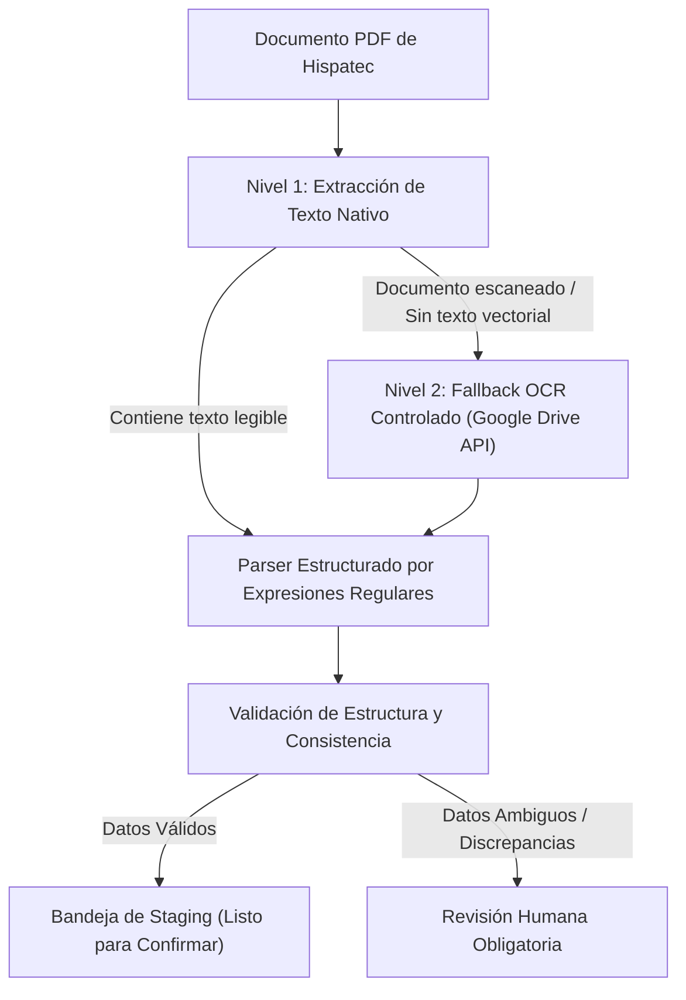
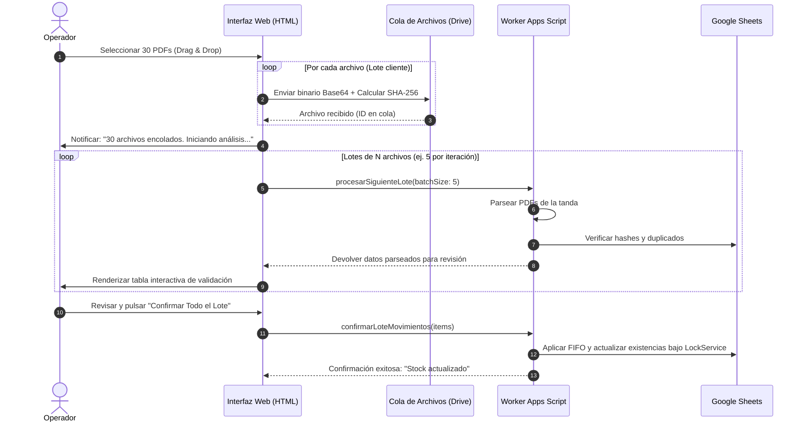

# IMPORT_SPECS.md — Especificaciones de Ingesta Documental y Extracción PDF

## 1. Estrategia de Extracción de Documentos PDF

Hispatec genera documentos con plantillas vectoriales donde el texto suele residir en capas seleccionables. STOCK-LIGHT aplica una **estrategia de extracción por niveles (tiered extraction)**:



### Reglas Clave:
1. **Prioridad Texto Nativo:** Extracción directa sin consumir cuotas de OCR de Google Drive ni incurrir en latencias de reconocimiento óptico.
2. **Prohibición de OCR Indiscriminado:** El OCR se activa única y exclusivamente como excepción cuando el PDF es puramente gráfico o carece de capas tipográficas.
3. **Cero Conjeturas:** Si un campo numérico no puede asociarse inequívocamente a "Cajas / Envases", el documento **nunca se contabiliza automáticamente**. Se detiene y se envía a la interfaz de revisión humana.

---

## 2. Especificación por Tipo de Documento Hispatec

### 2.1. Albarán de Compra (Entrada)
* **Objetivo:** Registrar ingresos de mercancía adquirida a proveedores o agricultores.
* **Mapeo de Campos:**

| Campo en Documento | Clasificación | Extraído como | Regla / Tratamiento |
| :--- | :---: | :--- | :--- |
| Fecha | Seguro | `fecha_documento` | Formato fecha del albarán convertida a `YYYY-MM-DD`. |
| Serie + Número | Seguro | `serie`, `numero` | Identificador del albarán (ej. `ACT26 / 12345`). |
| Proveedor | Seguro | `entidad_nombre` | Razón social o código de proveedor. |
| Código de Artículo | Seguro | `codigo_articulo` | Código numérico de artículo Hispatec (ej. `2112000`). |
| Descripción Artículo | Seguro | `nombre_articulo` | Denominación del producto (ej. `TOMATE ROSA M`). |
| Código de Envase | Seguro | `codigo_envase` | Código de envase si viene tipificado. |
| Descripción Envase | Seguro | `descripcion_envase`| Formato del envase (ej. `EPS 104`, `Madera 40x30`). |
| **Bultos / Envases / Cajas** | **Crítico** | **`cajas`** | **Único valor computable para el stock.** |
| Kilos (Bruto / Neto) | **Ignorado** | *Descartado* | **NO computable para stock.** No utilizar bajo ninguna circunstancia. |
| Partida | Informativo | `partida` | Almacenado como metadato informativo en la capa FIFO si existe. |
| Almacén | Informativo | `almacen` | Identificador del almacén de entrada si viene desglosado. |

---

### 2.2. Documento de Recepción de Mercancía (Excluido del MVP Activo)
> [!NOTE]
> Conforme a la Fase 2.1, el Documento de Recepción de Mercancía (medianería) queda **fuera del MVP activo**. El parser se conserva como módulo desacoplado para uso futuro, pero no se registra en el procesador activo de documentos.

---

### 2.3. Albarán de Salida (Fuente Activa Exclusiva de Salidas)
* **Objetivo:** Registrar la expedición de cajas vendidas o despachadas a clientes.
* **Mapeo de Campos:**

| Campo en Documento | Clasificación | Extraído como | Regla / Tratamiento |
| :--- | :---: | :--- | :--- |
| Fecha | Seguro | `fecha_documento` | Fecha de salida efectiva. |
| Serie + Número | Seguro | `serie`, `numero` | Identificador del albarán de venta (ej. `AVT26 / 8765`). |
| Cliente | Seguro | `entidad_nombre` | Razón social del destinatario comercial. |
| Código / Nombre Artículo | Seguro | `codigo_articulo` | Identificador del artículo expedido. |
| Envase / Presentación | Seguro | `codigo_envase` | Presentación del empaque vendido. |
| **Cajas Despachadas** | **Crítico** | **`cajas`** | **Cantidad real de cajas que se descuentan del FIFO.** |
| Kilos Salida | **Ignorado** | *Descartado* | Ignorado para el inventario de empaques. |

---

### 2.4. CSV de Hispatec: formatos reales y detección por columnas (T-030)

Los dos informes reales no tienen la misma cabecera que los primeros fixtures. El parser
(`src/importacion/CsvHispatecParser.js`) **no exige una cabecera exacta**: busca las columnas
obligatorias por nombre, en cualquier orden, sin distinguir mayúsculas, espacios sobrantes
ni la tilde de `Albarán`.

**Compras (entradas):**

```text
FechaAlbaran;NombreEmisor;SerieAlbaran;NumeroAlbaran;OrdenLinea;NumeracionProveedor;ReferenciaAC;NombreArticulo;DescripcionArticulo;UnidadesEnvase;CantidadLineaAlbaran;CantidadTotal;ReferenciaLineaAlbaran;ObservacionesLineaAlbaran;CantidadPrecioPor;Factor;PorCada;PesoBrutoLACCA;PesoNetoLACCA;NroPaletsAC;PaletAC;NombrePaletAC;CodigoEnvaseAC;NombreEnvaseAC;CantidadEnvasesAC
```

Columnas obligatorias: `FechaAlbaran`, `NombreEmisor`, `SerieAlbaran`, `NumeroAlbaran`,
`OrdenLinea`, `NombreArticulo`, `NombreEnvaseAC`, `CantidadEnvasesAC`.

**Ventas (salidas):**

```text
Fecha;Albarán;RefAV;RefLineaAV;NombreCliente;NombreArticulo;Cantidad;PesoNetoEnviado;CantidadPrecioPor;Piezas;Abreviatura;PrecioFunc;UdPrecio;ImporteNetoFunc;PesoNetoVendido;NroEnvases;NombreEnvase;NroPalets;Palet
```

Columnas obligatorias: `Fecha`, `Albarán`, `NombreCliente`, `NombreArticulo`, `NroEnvases`,
`NombreEnvase`.

Reglas de lectura:

- **COMPRAS** se detecta si están todas sus obligatorias; **VENTAS**, si están las suyas.
  Si faltan, el error nombra las columnas que faltan.
- Las columnas opcionales (`PesoNetoLACCA`, `PesoNetoEnviado`, `NroPalets`, etc.) se usan si
  están; si no, quedan vacías. En el formato antiguo, si viene `NroPalets` y falta `Palet`
  la cabecera se considera incompleta; en el formato real `Palet` es opcional.
- En ventas, serie, número y línea se extraen de `Albarán` con el formato
  `AVT27/783 (1)`. Si además existe una columna `Numero`, debe coincidir con el número del
  albarán; si no coincide, la línea queda en `ERROR_DATOS`.
- Las columnas de precio o importe (`PrecioFunc`, `UdPrecio`, `ImporteNetoFunc`, etc.) se
  ignoran y **nunca** se guardan en hojas ni en logs.
- Las filas vacías o formadas solo por separadores (`;;;;…`) se saltan sin error.
- Los decimales pueden venir con coma (`315,000`). Los dos informes usan CRLF y una fila
  final de separadores; ventas puede venir en UTF-8 (con `Ñ` y tildes) y compras en ASCII.
- La firma de líneas (`firma_lineas`, T-007) se calcula con los campos normalizados
  (línea, artículo, envase y cajas), no con la línea cruda ni con el orden de las columnas.
  Por eso el mismo contenido en el formato antiguo y en el real da la misma firma.

### 2.5. Exclusiones de líneas (T-031, D-039)

**Clientes excluidos.** La hoja `CLIENTES_EXCLUIDOS` contiene patrones (`patron`) que se
comparan con la entidad normalizada de cada línea de venta (mayúsculas, sin acentos ni
espacios sobrantes). Si la entidad contiene un patrón activo, la línea queda
`CLIENTE_EXCLUIDO`:

- no genera movimientos ni pendientes;
- no cuenta como falta de stock;
- se cuenta aparte en la previsualización y en `IMPORTACIONES.lineas_cliente_excluido`.

Ejemplo ficticio: con el patrón `CLIENTE FICTICIO`, una venta a «Cliente Ficticio, S.L.» no
toca stock; una venta a «Destinatario Inventado» sí descuenta.

**Nombres comerciales fuera.** Se configuran como reglas de catálogo
`SEGUIMIENTO = NO` con prioridad alta (por encima de «TOMATE → SI»). No hay nombres en el
código. Ejemplo ficticio: `NOMBRE COMERCIAL X` hace que «TOMATE NOMBRE COMERCIAL X EXTRA»
quede `NO_SEGUIDA`, mientras que «TOMATE FICTICIO» sigue contando.

Las dos configuraciones se hacen desde el editor con
`adminConfigurarClientesExcluidos(...)` y `adminConfigurarArticulosFuera(...)`, que son
idempotentes y exigen ser propietario del script.

### 2.6. Informe de RECEPCIONES de Hispatec (T-032, D-040)

Las entradas se importan del informe de **recepción física** de Hispatec, no del informe de
compras. La cabecera real tiene dos columnas sin nombre y estas columnas útiles:

```text
Almacen;FechaRecepcion;CodigoProveedor;Referencia;Recepción;Asociación;
DescripcionArticulo;Envase;NroEnvases;NroPalets;Numero;Partida;Cantidad;...
```

- Se reconoce como `RECEPCIONES` si están `Almacen`, `FechaRecepcion`, `Recepción`,
  `DescripcionArticulo`, `Envase` y `NroEnvases`.
- Una fila es de datos si tiene `FechaRecepcion`, `Recepción` y `DescripcionArticulo`.
- El proveedor no es una columna: viene en la fila anterior `NombreProveedor: ...`. Una
  línea sin proveedor anterior es `ERROR_DATOS`. Las filas de empresa, separadores y finales
  se saltan.
- De `Recepción` se obtiene: serie (lo anterior a `/`, o `REC` si está vacío), número (entre
  `/` y el espacio) y línea (entre paréntesis). Ejemplos ficticios: `/11737 (1)` y
  `RNT27/26 (2)`.
- La fecha es `FechaRecepcion` (nunca `FechaCreacion`), la entidad es el proveedor, las
  cajas son `NroEnvases`, los kg son `Cantidad`, el envase es `Envase` y la **partida** es
  `Partida`. La partida llega hasta la capa FIFO.
- Cuentan las series `REC`, `NT` y `RNT`; es una lista propia de recepciones y no cambia la
  lista de ventas.
- El artículo de `DescripcionArticulo` se normaliza (mayúsculas, espacios colapsados, sin
  sufijo final `KG`, `UNID` o `UND`). Si hay una equivalencia activa en
  `EQUIVALENCIAS_ARTICULO` se usa su `nombre_articulo`; si no, el nombre normalizado.
  Las equivalencias son solo de nombre de artículo, **nunca de envase**.
- Una línea seguida cuyo artículo no ha aparecido en ventas (CATALOGO o MOVIMIENTOS de
  salida) lleva el aviso `SIN_PAREJA_EN_VENTAS` en la previsualización. No bloquea la
  importación.

**Fuente única de entradas.** La propiedad `FUENTE_ENTRADAS` vale `COMPRAS` o
`RECEPCIONES`. Con `RECEPCIONES`, un CSV de COMPRAS se rechaza en la previsualización con
«Las entradas se importan con el informe de recepciones». Se cambia con
`adminConfigurarFuenteEntradas(...)`.

---

## 3. Catálogo de Campos Dudosos o Dependientes de Formato

Antes de iniciar la codificación de los parsers definitivos, deben clarificarse los siguientes puntos con documentos reales:

| Campo / Situación | Nivel de Riesgo | Duda Concreta | Acción de Mitigación |
| :--- | :---: | :--- | :--- |
| **Ambigüedad en Envase sin Código Numérico** | Alto | Algunos albaranes imprimen solo la descripción libre del envase (ej. "Caja Verde") sin el código formal de Hispatec. | Mapeo por tabla de sinónimos en la hoja `MAESTRO`. Si no se encuentra, detención para asignación manual. |
| **Subtotales de Palets vs Cajas** | Medio | Documentos que listan "Palets" y "Cajas por Palet" junto al total de cajas. | El parser debe validar que $\text{Palets} \times \text{Cajas/Palet} = \text{Total Cajas}$ y extraer únicamente el total final de cajas. |
| **Partida Múltiple en una misma línea** | Medio | Si una sola línea de albarán agrupa dos partidas diferentes con un total de cajas conjunto. | Se asigna a la capa FIFO con indicación de partidas múltiples o se desglosa si el documento trae subtotales. |
| **Albaranes Rectificativos / Devoluciones** | Medio | Signos negativos dentro de un albarán de salida o compra. | Validar si Hispatec utiliza series diferenciadas o líneas en negativo. |

---

## 4. Pipeline de Carga Masiva (Batch Processing)

El usuario debe poder subir lotes de 20, 30 o más PDFs de una sola vez sin que el sistema bloquee el navegador ni agote el tiempo máximo de Apps Script (6 minutos).



---

## 5. Muestras Reales Requeridas en el Workspace

Para calibrar los patrones de expresiones regulares y la extracción de datos sin inventar formatos ni vulnerar el aislamiento de carpetas:

> [!IMPORTANT]
> Se solicita depositar copias de documentos reales de muestra en la carpeta local:  
> `<RUTA_LOCAL_DEL_PROYECTO>\docs\samples\`
> 
> Documentos necesarios:
> 1. Al menos **2 ejemplos de Albarán de Compra** (con diferentes proveedores y artículos).
> 2. Al menos **2 ejemplos de Recepción de Mercancía** (incluyendo medianería y bloque de resumen inferior).
> 3. Al menos **2 ejemplos de Albarán de Salida** (con diversos clientes y formatos de envase).
> 4. Copia o exportación de la **Hoja de Maestros** de artículos y envases oficiales de Hispatec.
> 5. Ejemplos de **archivos CSV** de apoyo si se utilizaron previamente para pruebas.
