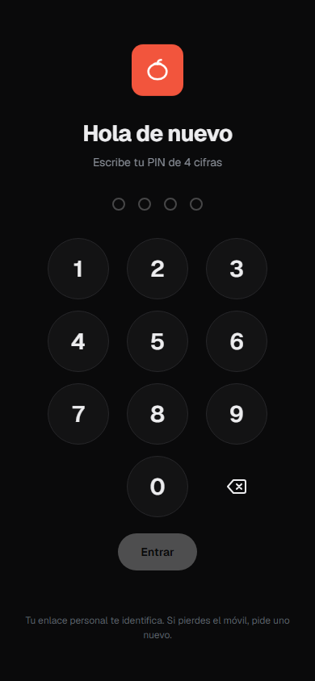
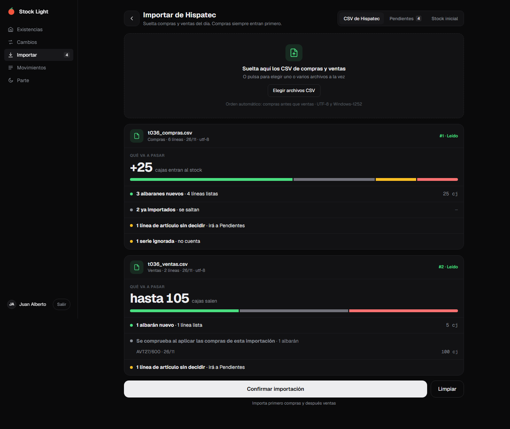
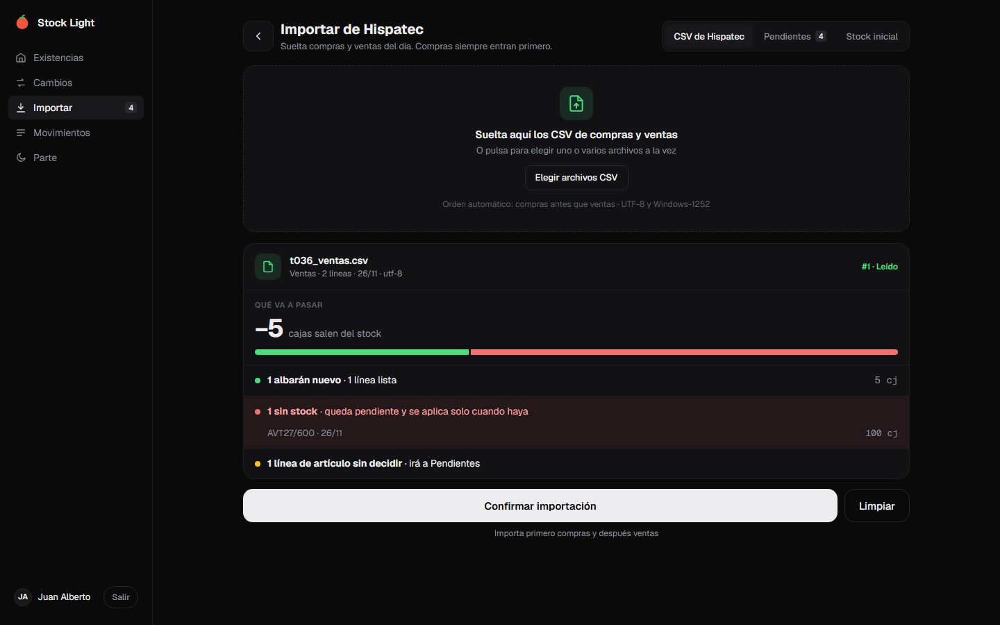
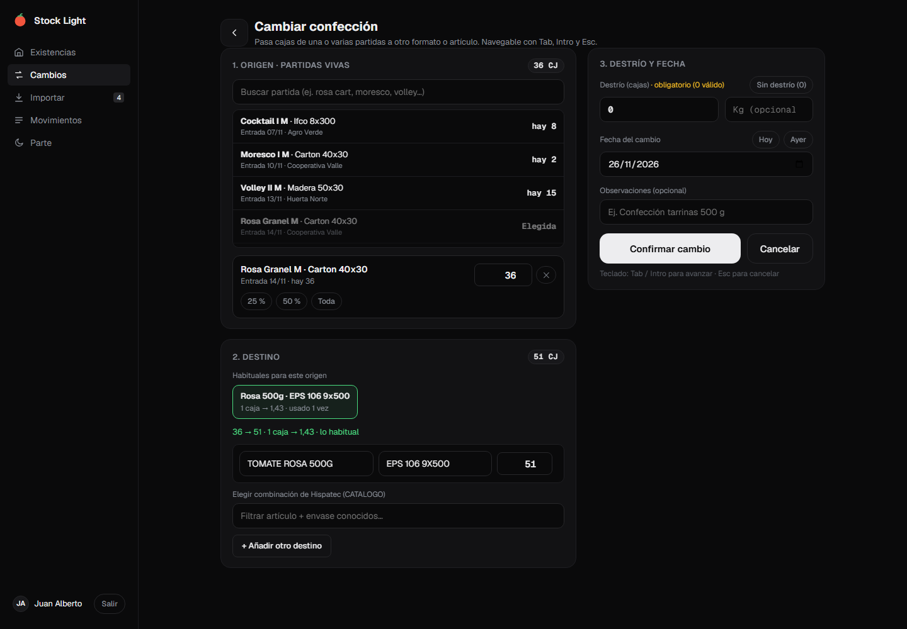
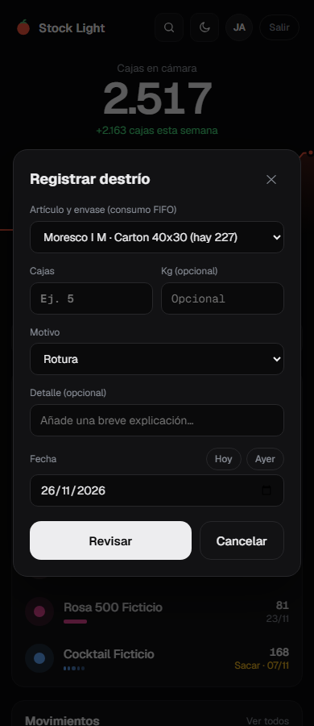
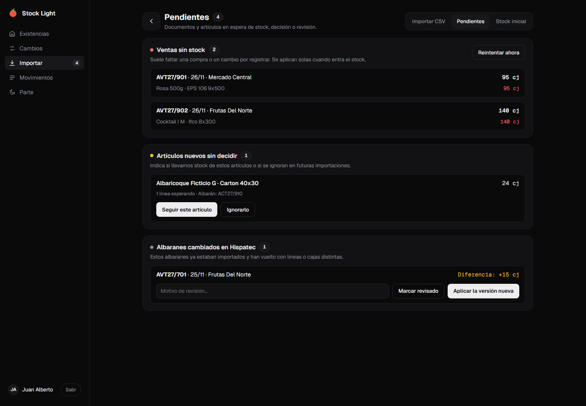
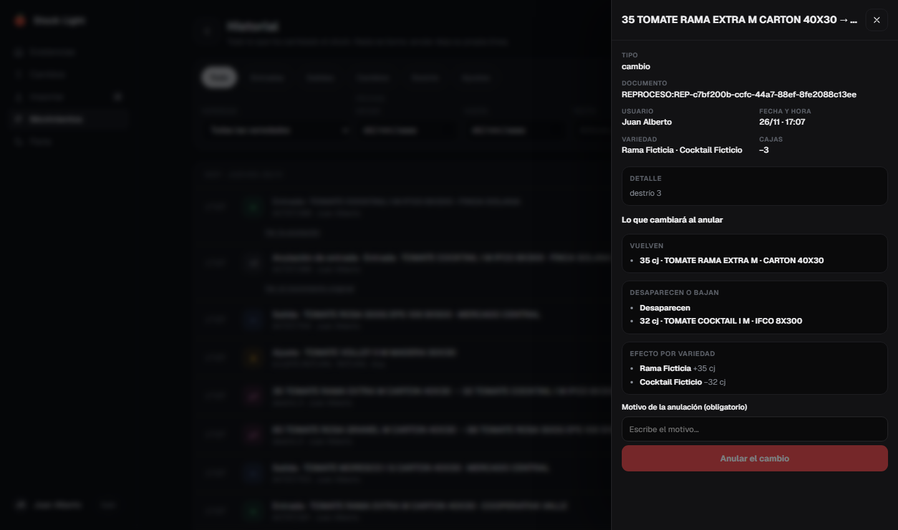
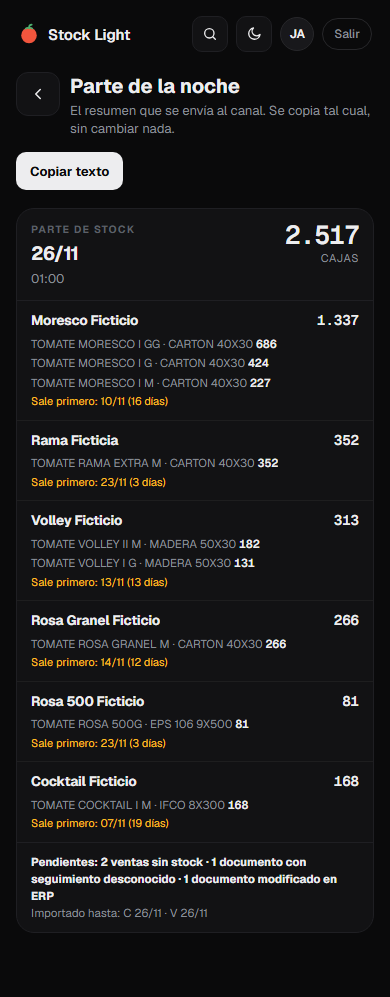
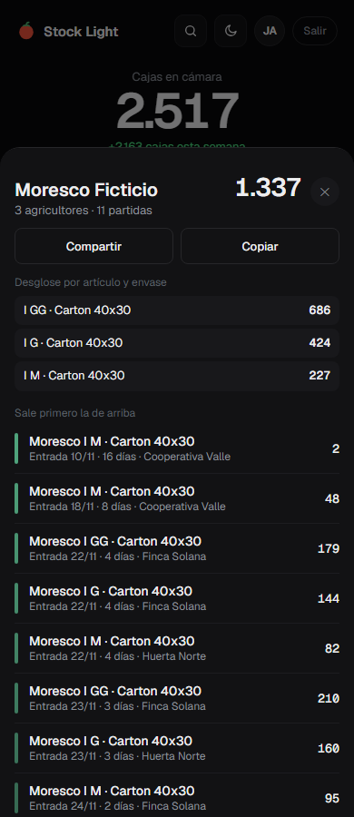
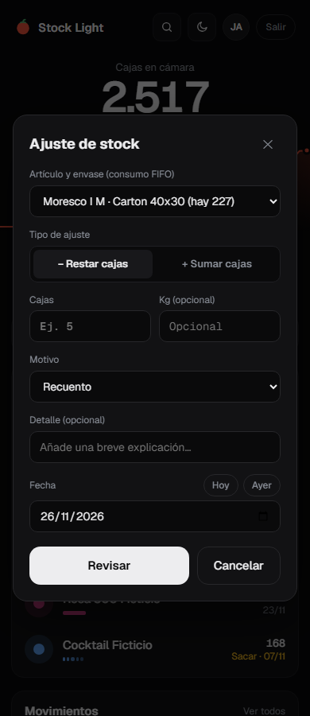

# Guía de uso diario

Esta guía explica lo que se hace cada día en Stock Light. Está pensada para el administrativo (ordenador) y para los comerciales (móvil). Las imágenes son de la vista previa con datos inventados: no hay ningún dato real.

## 1. Entrar

1. Abre en el móvil el **enlace personal** que te ha enviado el responsable. Es tuyo y no se comparte.
2. La primera vez, elige un **PIN de 4 a 6 cifras**. Después, escribe ese PIN cada vez que entres.
3. Para tenerlo a mano, abre el menú del navegador y elige **Añadir a pantalla de inicio**. Así entras como una app, sin buscar el enlace.
4. Si olvidas el PIN, pide al responsable un **enlace nuevo**. No hay forma de recuperar el PIN antiguo.

## 2. Cada mañana (administrativo, ordenador)

1. En Hispatec, exporta el informe de **recepciones** y el de **ventas** del día anterior. No los abras ni los cambies: se importan tal cual.
2. En Stock Light, entra en **Importar**. Arrastra los dos archivos a la vez o pulsa **Elegir archivos CSV**.
3. La app pone sola las compras antes que las ventas. Espera a que termine de leerlos y revisa la vista previa.
4. Si todo tiene sentido, pulsa **Confirmar importación**. Si te has equivocado de archivo, pulsa **Limpiar** y vuelve a empezar.

Qué significa cada fila de la vista previa:

- **Albaranes nuevos / líneas listas:** se van a aplicar. El número grande indica las cajas que entran o salen.
- **Ya importados:** ese albarán ya estaba en la app y se salta. No se duplica.
- **Modificados en Hispatec:** el albarán ya existía, pero ahora trae otras líneas o cajas. Pasará a **Pendientes** para que decidas con la versión nueva.
- **Sin stock:** la venta no tiene cajas suficientes. Queda pendiente y se aplicará sola cuando entre la compra o el cambio que falta. En la imagen de abajo se ve una venta sin stock.
- **No se lleva:** la serie no cuenta, el artículo no se sigue o es un abono. No mueve stock.
- **Cliente excluido:** las ventas de ese cliente no pasan por el almacén. No cuentan.
- **Artículo sin decidir:** es la primera vez que aparece ese artículo. Irá a **Pendientes** para que elijas **Seguir** o **Ignorar**.

## 3. Cambios de confección (Cambiar)

Los cambios se registran **el mismo día**, sobre todo cuando se pasa de granel a 500 g. Así el stock y las partidas cuadran.

1. En la barra lateral, entra en **Cambios**. La pantalla se llama **Cambiar confección**.
2. En **1. Origen**, busca y elige la partida que vas a gastar. La app enseña primero las más antiguas: son las que deben salir antes.
3. En **2. Destino**, elige una **sugerencia habitual** si aparece (por ejemplo, «Rosa 500g · EPS 106 9x500»). La app calcula las cajas de destino con la proporción de veces anteriores. Puedes corregir las cajas a mano.
4. En **3. Destrío y fecha**, escribe las cajas que se pierden. Si no se pierde ninguna, pulsa **Sin destrío (0)**. Si cambias de envase, el destrío es obligatorio, pero **0 es un valor válido**.
5. Revisa la fecha y pulsa **Confirmar cambio**.
6. Si te has equivocado, en la pantalla de resultado pulsa **Deshacer**. Antes de deshacer se enseña qué cajas vuelven y qué partidas desaparecen.

## 4. Destrío y ajustes

- **Desde una partida:** abre la partida y pulsa **Destrío**. El descuento se hace sobre esa partida concreta. En la misma pantalla tienes **Ajuste** para sumar o restar cajas por un recuento.
- **Desde la barra:** en el móvil, pulsa **Destrío** en la barra de acciones. Si no eliges partida, la app descuenta primero la más antigua (la que sale antes).
- Elige el **motivo** (Rotura, Podrido, Calidad, Recuento, Error de carga u Otro). Si eliges **Otro**, escribe una nota.
- Pulsa **Revisar** y, cuando esté correcto, **Confirmar destrío** o **Confirmar ajuste**.

## 5. Pendientes

En **Pendientes** hay tres bloques:

1. **Ventas sin stock.** Se aplican solas cuando entra el stock que falta (una compra o un cambio). Si acaba de entrar, pulsa **Reintentar ahora**.
2. **Artículos nuevos sin decidir.** Elige **Seguir este artículo** si quieres llevar su stock (y di en qué variedad va) o **Ignorarlo** si no se va a seguir.
3. **Albaranes cambiados en Hispatec.** Pulsa **Aplicar la versión nueva**. Se abre una vista previa con lo que se deshace, lo que se rehace y las ventas que pasarán a pendientes. Escribe el **motivo** y confirma. Si la versión no mueve stock, la app lo avisa en gris.

## 6. Corregir un error

- **Si el error está en Hispatec** (una compra o una venta): corrígelo en Hispatec y vuelve a importar el archivo. La app detecta el albarán como **Modificado en Hispatec** y te deja aplicar la versión nueva desde **Pendientes** con su vista previa y su motivo.
- **Si el error es de una operación hecha en la app** (un cambio, un destrío o un ajuste): entra en **Movimientos**, abre la operación y pulsa **Anular el cambio**, **Anular el destrío** o **Anular el ajuste**. Antes de confirmar se enseña qué vuelve y qué desaparece, y el motivo es obligatorio.
- No uses **Movimientos** para “arreglar” una compra o una venta de Hispatec: para esas, corrige el archivo y reimporta.

## 7. Parte de la noche

1. Entra en **Parte** desde la barra lateral, desde el icono de luna del móvil o desde el botón **Parte de la noche** que hay junto a **Importar CSV** en el ordenador.
2. Revisa la fecha, la hora, el total y el desglose de cada variedad con «sale primero».
3. Pulsa **Copiar texto**. El botón cambia a **Copiado** y el texto queda listo para pegar en el canal de WhatsApp.
4. El correo del parte se envía solo por la noche (por defecto, a las 21:00).

## 8. Comerciales (móvil)

1. Abre tu enlace y entra con el PIN.
2. En **Existencias** ves el total de cajas y las variedades, con el aviso **Sacar** cuando una partida ya tiene días.
3. Pulsa una variedad para ver el **desglose por artículo y envase** y las partidas ordenadas de la más antigua a la más nueva, con el agricultor y los días que tiene.
4. Pulsa **Compartir** para enviarlo por WhatsApp o **Copiar** para pegar el resumen donde quieras.
5. Para buscar algo concreto, usa la lupa del móvil o la barra **Buscar variedad o artículo**.

## 9. Preguntas frecuentes

- **«La venta no descuenta.»** Mira en **Pendientes → Ventas sin stock**. Suele faltar la compra o el cambio que la abastece. Cuando entre, se aplica sola; si ya ha entrado, pulsa **Reintentar ahora**.
- **«Sale un artículo raro.»** Está en **Pendientes → Artículos nuevos sin decidir**. Pulsa **Seguir este artículo** si lo vas a llevar o **Ignorarlo** si no. Así dejará de aparecer en futuras importaciones.
- **«El stock no cuadra con la cámara.»** Abre la partida y pulsa **Ajuste**, o abre la variedad en el ordenador y usa **Ajuste**. Elige **Recuento**, escribe las cajas que faltan o sobran, revisa y confirma. El motivo **Recuento** deja claro que es una diferencia de inventario.

## Recordatorios rápidos

- Las compras y las ventas se importan juntas; la app pone el orden.
- Un albarán no se borra: se corrige en Hispatec y se aplica la versión nueva.
- Los cambios, destríos y ajustes se pueden deshacer desde **Movimientos**, siempre con vista previa y motivo.
- El parte se copia tal cual; no hace falta retocarlo.
